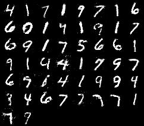
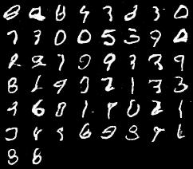
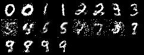
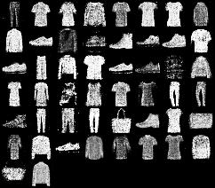
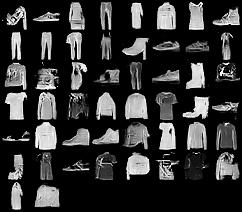
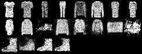

# GAN Architecture Comparison

[Portfolio Page](https://app.notion.com/p/3e968564df5a8108bf64effa42fb6991)

A PyTorch comparison of **Vanilla GAN, DCGAN, and Conditional GAN (CGAN)** on **MNIST** and **Fashion-MNIST**, examining six model–dataset combinations of generated 28×28 grayscale images.

**Technologies:** Python, PyTorch, Torchvision, TensorBoard.

## Approach

### Models

| Model | Generator / Discriminator | Key idea |
|---|---|---|
| Vanilla GAN | Fully connected layers | Baseline adversarial image generation |
| DCGAN | ConvTranspose2d / Conv2d | Learns spatial image features with convolutional layers |
| CGAN | Fully connected layers + class condition | Generates images conditioned on class labels |

### CGAN implementation note

In this implementation, each scalar class label is expanded to the same width as the latent vector for the Generator and to the flattened image width for the Discriminator. The expanded condition is then concatenated with the corresponding input. It does **not** use one-hot encoding or a learned label embedding.

### Experiment Setup

- Datasets: MNIST, Fashion-MNIST
- Image size: 28 × 28, grayscale
- Latent dimension: 100
- Batch size: 100
- Optimizer: Adam
- Generator learning rate: 0.0002
- Discriminator learning rate: 0.0002
- Adam betas: (0.5, 0.999)
- Maximum epochs: 40
- Loss: Binary Cross Entropy

### Training Workflow

1. Load the selected training dataset and normalize pixels to approximately `[-1, 1]`.
2. Sample Gaussian latent vectors and generate images.
3. Update the Discriminator using real images and detached generated images.
4. Sample new latent vectors and update the Generator through the Discriminator.
5. Log losses, generate preview grids, and save model checkpoints.

## Results

Original coursework samples for all six model–dataset combinations are shown below. No FID or other quantitative image-quality metric was measured.

| Dataset | Vanilla GAN | DCGAN | CGAN |
|---|---|---|---|
| MNIST |  |  |  |
| Fashion-MNIST |  |  |  |

## Repository Structure

```text
gan-architecture-comparison/
├── config/              # MNIST/Fashion-MNIST × 3 model configs
├── models/
│   ├── gan.py           # Vanilla GAN + shared GAN losses
│   ├── dcgan.py         # DCGAN
│   └── cgan.py          # Conditional GAN
├── scripts/
│   └── train_gan.py
├── results/             # Six generated sample images
├── .gitignore
├── README.md
└── requirements.txt
```

## Usage

From the repository root:

```bash
pip install -r requirements.txt
python scripts/train_gan.py config/mnist_vanilla.yaml
python scripts/train_gan.py config/mnist_dcgan.yaml
python scripts/train_gan.py config/mnist_cgan.yaml
```

Replace `mnist` with `fashion` to run the Fashion-MNIST experiments. Torchvision downloads the selected dataset automatically.

Each run writes artifacts under `runs/<timestamp>/`:

| Directory | Contents |
| --- | --- |
| `checkpoints/` | Generator and Discriminator weights saved each epoch |
| `images/` | Generated preview grids saved every 300 training steps |
| `summaries/` | TensorBoard Generator and Discriminator loss logs |

To inspect training logs:

```bash
tensorboard --logdir runs
```

## Limitations

No FID, repeated-seed comparison, class-consistency score, or systematic diversity measurement is reported. Raw scalar labels also impose a numeric representation on categorical classes; one-hot conditions or learned label embeddings would be useful alternatives to compare.

## Data and Third-party Resources

- **Datasets:** MNIST and Fashion-MNIST are downloaded by Torchvision at runtime. Review the dataset owners' terms for any redistribution of derived samples.
- **Environment:** generated weights and run folders are excluded.

Dependency lists are in `requirements.txt`; unless versions are explicitly pinned there, they do not reproduce an exact historical software environment. No redistribution permission for third-party inputs is implied by this repository.
